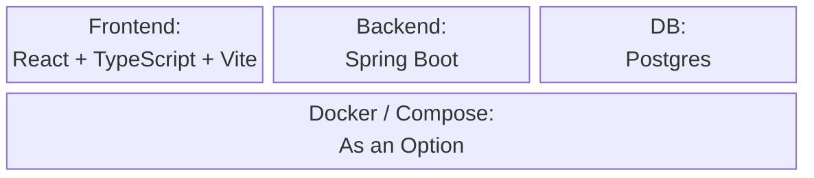
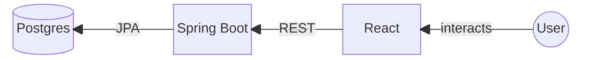
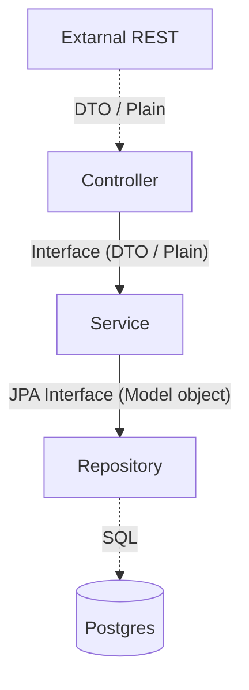

# Presentation

## 1.Implementation Overview

### Tech stack

### Tools/services integrated
 
#### General
- mermaid &rarr; Graphs in Markdown
- assertj, cucumber-java, junit, h2, .. &rarr; Standard Java Testing

#### CI
- Dependabot &rarr; Update Dependencies
- Build & Test on Push via Maven
- checkstyle &rarr; check Styling

### High-level architecture diagram

#### Backend

### Key implementation specifics

#### Hashed & Salted Passwords
Using Argon2 _[see also](https://argon2.online/)_
- Not Plaintext passwords via Hashing
- Salt blocks Rainbow tables

#### REST API
- Using DTO's
- Spring Annotations for
  - Request Parameters
  - Body
  - Methods

### State management
Entirely handled by DB.

_no real logged in "State" Supported_

### Data model
Using the JPA Entity Framework

## 2.Requirements Recap

### What were the initial functional and quality requirements in your team?

### Which ones were implemented successfully during the exercises?

| Initial functional and quality requirements | Implemented functional and quality requirements|
|---|---|
|**1. Task Management**||
|Users must be able to create, edit and delete tasks | ✅|
|Each task must have the following features:  - Title - Description - Due Date - Priority Level | ✅|
|Users should be able to edit existing tasks (to update status or modify details) | ✅|
|**2. Task Status Management**||
|Possible status for tasks: - "Open" - "In Progress" - "Done" - "Overdue" (The date of the task has passed) | ✅|
|The system must automatically change a task's status to "Overdue" if the due date has passed and the task is not marked as "Done" | ❌|
|**3. Task Organization**||
|Tasks should be grouped into categories or projects to help users structure their workload|❌|
|Users should be able to view and manage tasks within these categories|❌|
|**4. User Allocation & Collaboration**||
|Users can assign tasks to themselves or other team members|✅ (In fact they can assign a task to everybody by using the id of a user)|
|Users should have the option to assign tasks to multiple team members if needed|❌|
|The system should notify assigned users automatically when they receive a new task|❌|
|The system should notify assigned users via email or in-app notifications|❌|
|**5. Time & Deadline Awareness**||
|Tasks should have due dates that users can set and modify|✅|
|The system must provide reminders/alerts for upcoming or overdue tasks|❌|
|Reminders should not unnecessary distract the user|(✅) Non existing can not distract|
|**6. System Architecture**||
|FocusFlow must have a 3-tier architecture: - Database (Stores tasks and user data) - API Backend (Manages data access and business logic) - Frontend (Provides the user interface)|✅|
|The system should be a web-based application, so it can be accessed from multiple devices|✅|
|**7. User Interface & Usability**||
|The UI should be simple, clear and easy to navigate|✅|
|The system should allow users to quickly find, create and update tasks without complex menus|✅|
|Therefore users should be able to start using the system without training|✅|
|**8. System Extensibility & Future Enhancements**||
|The system should be modular, so that: - Future feature expansions are possible - Easy updates to UI, database and backend are possible|✅|

### Which were postponed, dropped, or changed (and why)?
Due to limited time some requirements are not met yet (see table above), so instead of going for all of nothing we focused on the requirements that were most important to use in terms of delivering working software, where the different tests could be implemented.

### Which UI / UX factors were considered in your design?
| **UX Factor**        | **How We Considered It in FocusFlow**                                                                                                                   |
|----------------------|--------------------------------------------------------------------------------------------------------------------------------------------------------|
| **Helpfulness**      | • Contextual tooltips on buttons and forms • Onboarding overlay guiding users through core actions (Create, Edit, Delete tasks)                     |
| **Efficiency**       | • Fixed, collapsible sidebar for quick navigation (Dashboard, Calendar, Projects) • Keyboard shortcuts (`N` = new task, `/` = search)             |
| **Relevancy**        | • “My Tasks” vs. “Team Tasks” tabs showing only relevant items • Smart filters (due this week, overdue, by priority)                                |
| **Simplicity**       | • Clean, minimal color palette with clear typography • Single-page layout for core workflows (no deep menu trees)                                    |
| **Trust/Credibility**| • Secure login (JWT + HTTPS by default) • “Privacy & Data” link in footer and “Last updated” timestamp on tasks for transparency and reliability |

## 3.Retrospective & Lessons learned

### Overview of organization of tasks (Team leaders, frontend, backend ,etc.)

The roles which were set in the [1st Lab](../Lab1_ProjectSetup&TechSelection/Roles.md) mainly stayed. But everyone worked in the backend, since this was the main focus of the Lab.

For Documentation there was happened not to be a single person that was responsible which changed every lab, but everyone made the documentation regarding their work.

The leading role was also pretty fluid and depended on prior knowledge or simply availability, caused by other responsibilities, since a week can go by fast.

### What were the biggest challenges during development?

- Reviewing of Pull requests with a lot of changes

### What worked well? What didn't?

- Communication in the team
- Working with the GitHub Repository

### Which exercise helped the most or was the most interesting for your team?

- Gherkin Syntax and BDD
- CI-Pipeline
- E2E-Testing (nice to see how the whole surface of an application can be tested, and easy to set up so quite comfortable to use)

### What would your team do differently in the next iteration?

### What would your team suggest to change during the lecture / course?
- Forum in Moodle, so you can get answers regarding Lab questions (Either from Professor, or other students)