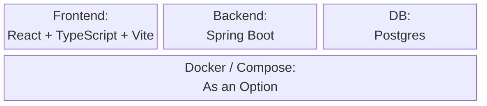
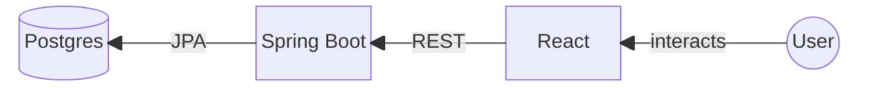
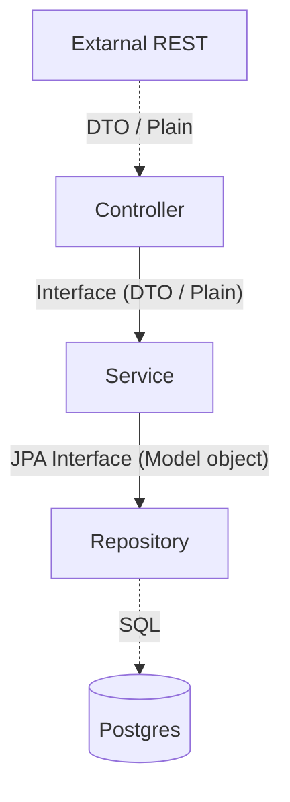

# Presentation

## 1.Implementation Overview

### Tech stack

### Tools/services integrated
 
#### General
- mermaid &rarr; Graphs in Markdown
- assertj, cucumber-java, junit, h2, .. &rarr; Standard Java Testing

#### CI
- Dependabot &rarr; Update Dependencies
- Build & Test on Push via Maven
- checkstyle &rarr; check Styling

### High-level architecture diagram

#### Backend

### Key implementation specifics

#### Hashed & Salted Passwords
Using Argon2 _[see also](https://argon2.online/)_
- Not Plaintext passwords via Hashing
- Salt blocks Rainbow tables

#### REST API
- Using DTO's
- Spring Annotations for
  - Request Parameters
  - Body
  - Methods

### state management
Entirely handled by DB.

_no real logged in "State" Supported_

### data model
Using the JPA Entity Framework

## 2.Requirements Recap

### What were the initial functional and quality requirements in your team?

### Which ones were implemented successfully during the exercises?

### Which were postponed, dropped, or changed (and why)?

### Which UI / UX factors were considered in your design?

## 3.Retrospective & Lessons learned

### Overview of organization of tasks (Team leaders, frontend, backend ,etc.)

The roles which were set in the [first Lab](../Lab1_ProjectSetup&TechSelection/Roles.md) mainly stayed. But everyone worked in the backend, since this was the main focus of the Lab.

For Documentation there was happened not to be a single person that was responsible which changed every lab, but everyone made the documentation regarding their work.

The leading role was also pretty fluid and depended on prior knowledge or simply availability, caused by other responsibilities, since a week can go by fast.

### What were the biggest challenges during development?

- Reviewing of Pull requests with a lot of changes

### What worked well? What didn´t?

- Comunication in the team
- Working with the GitHub Repository

### Which exercise helped the most or was the most interesting for your team?

- Gherkin Syntax and BDD
- E2E (nice to see how the whole surface of an application can be tested, and easy to set up so quit comfortable to use)

### What would your team do differently in the next iteration?

### What would your team suggest to change during the lecture / course?
